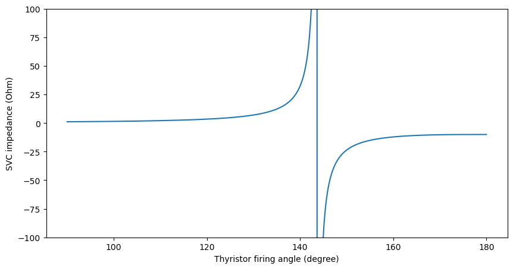
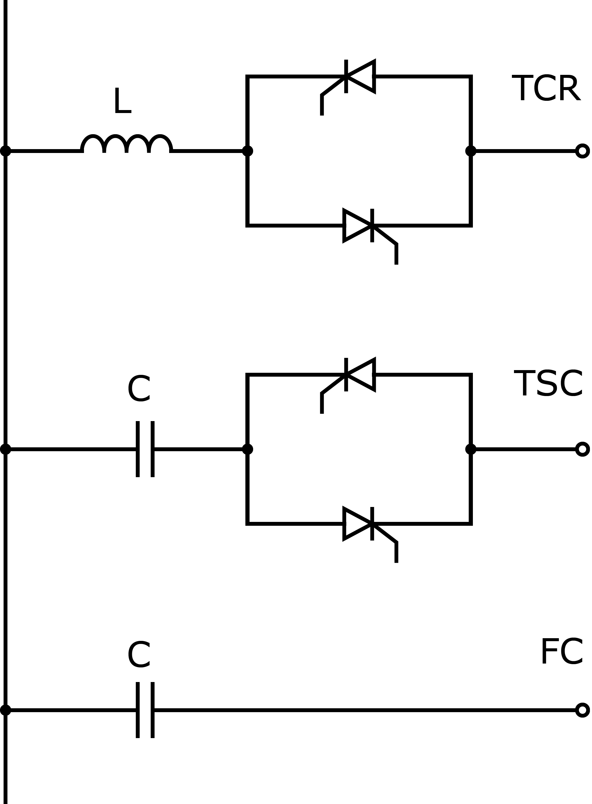

.. _svc:

==============================
Static Var Compensator (SVC)
==============================

We implement the FACTS devices based on the following source:

    A. Panosyan, "Modeling of advanced power transmission system controllers",
    Ph.D. dissertation, Gottfried Wilhelm Leibniz Universität Hannover, 2010.

The element SVC is a shunt-connected thyristor-based power electronic device. It regulates the voltage magnitude at the
connected bus by adjusting the shunt impedance value. The shunt impedance only has the reactance component
(no resistive part). The impedance can be capacitive or inductive, because the device consists of a fixed capacitor in
a parallel circuit to the reactor that is regulated by a pair of antiparallel thyristors.
The thyristor firing angle regulates the total impedance of the element.

The active range of the device is presented in the figure below:

It can be seen that the device has a resonance region
between the inductive (positive) and the capacitive (negative) impedance characteristics.
In real application, the operation of the device in the resonance region is prohibited by defining the inadmissible
range for the thyristor firing angle around the resonance point. We did not implement this in our software - this
should be considered for future work.

The device operates with a thyristor firing angle between 90° and 180°.
By default, ``runpp`` does not enforce ``min_angle_degree`` and ``max_angle_degree``.
Pass ``enforce_facts_limits=True`` to enforce these limits for controllable, in-service SVCs and TCSCs.
The limits must satisfy ``90 <= min_angle_degree <= max_angle_degree <= 180``.
A device that reaches a bound temporarily stops controlling its setpoint and acts as a fixed impedance;
its voltage or power target may therefore be missed. It can resume control if a later trial solution
keeps its angle within the bounds.

Firing angle limits and generator Q limits share one outer loop. Each round fixes the largest violation
relative to the device's adjustable range. Generators fixed at a Q limit are not released.
Repeated control states or an outer iteration limit cause a warning and return the last solved state;
this does not guarantee that all setpoints or firing angle limits are satisfied.
The boolean result column ``at_limit`` identifies controllable, in-service devices at an angle bound
when enforcement is enabled, and is False otherwise.

We demonstrate the use-case of this device in the
pandapower tutorial: `FACTS <https://github.com/e2nIEE/pandapower/blob/develop/tutorials/FACTS.ipynb>`_.

.. seealso::
    :ref:`Unit Systems and Conventions <conventions>`

Create Function
=====================

.. autofunction:: pandapower.create.create_svc

Table Structure
=====================

*net.svc*

.. csv-table::
    :file: table_structures/svc.csv
    :header-rows: 1
    :delim: ,

Electric Model
=================

The shunt impedance :math:`X_{SVC}` of the SVC element is calculated according to the following equation:

.. math::
   :nowrap:

   \begin{align*}
   X_{SVC} &= \frac{\pi X_L}{2 (\pi - \alpha) + \sin{(2\alpha)} + \frac{\pi X_L}{X_{Cvar}}}
   \end{align*}

The term :math:`X_L` stands for the reactance of the reactor (x_l_ohm) and the term :math:`X_{Cvar}` stands for the
total capacitance (x_cvar_ohm). The thyristor firing angle :math:`\alpha` is the state variable that on the one hand
defines the impedance of the element, and at the same time is the result of the Newton-Raphson calculation.

The reactive power consumption of the SVC element is calculated with:

.. math::
   :nowrap:

   \begin{align*}
   Q_{SVC} = \frac{V^2}{X_{SVC}}
   \end{align*}

Where V is the complex voltage observed at the connection bus of the SVC element.
The reference values for the per unit system as defined in :ref:`Unit Systems and Conventions<conventions>`.

Result Table
==========================
*net.res_svc*

.. csv-table::
    :file: table_structures/res_svc.csv
    :header-rows: 1
    :delim: ,
