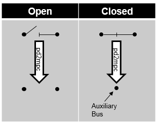
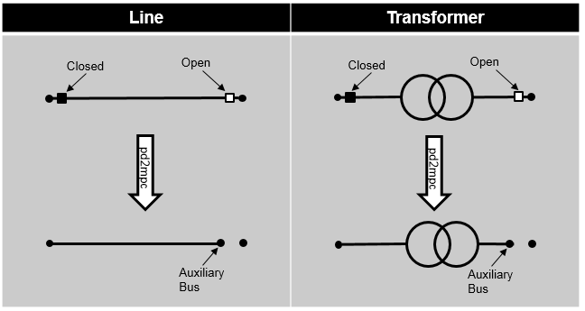

.. _switch_model:

=============
Switch
=============

Create Function
=====================

.. autofunction:: pandapower.create.create_switch
.. autofunction:: pandapower.create.create_switches

Table Structure
=====================

*net.switch*

.. csv-table::
    :file: table_structures/switch.csv
    :header-rows: 1
    :delim: ,

.. note::

   The columns ``measured_temperature_rise_kelvin``, ``temperature_rise_exponent``,
   ``thermal_time_constant_minutes`` and ``air_temperature_degree_celsius`` are only used by the
   switch thermal calculation of the temperature dependent power flow (``runpp(tdpf=True)``). They are
   optional and fall back to documented assumptions if they are missing.

   
Electric Model
=================

*Bus-Bus-Switches:*

Two buses that are connected with a closed bus-bus switches are fused internally for the power flow, open bus-bus switches are ignored:

This has the following advantages compared to modelling the switch as a small impedance:

    - there is no voltage drop over the switch (ideal switch)
    - no convergence problems due to small impedances / large admittances
    - less buses in the admittance matrix

.. note::

   Because fused buses share one internal node, ``res_switch`` contains NaN for
   bus-bus switches with ``z_ohm=0`` after ``runpp()``.  To compute the power
   flow through these switches via nodal balance, call
   :func:`pandapower.toolbox.compute_switch_flows` after the load flow.

   For the switch temperature in ``runpp(tdpf=True)``, the flow of a fused bus-bus switch
   (``z_ohm=0``) is reconstructed automatically with
   :func:`pandapower.toolbox.compute_switch_flows`, so it gets a temperature as well. A
   bus-trafo3w switch (``et="t3"``) has no solved current and is skipped. Use
   ``z_ohm > 0`` to model a bus-bus switch as an explicit branch.

*Bus-Element-Switches:*

When the power flow is calculated internally for every open bus-element switch an auxiliary bus is created in the pypower case file. The pypower branch that corresponds to the element is then connected to this bus. This has the following advantages compared to modelling the switch by setting the element out of service:

    - loading current is considered
    - information about switch position is preserved
    - difference between open switch and out of service line (e.g. faulty line) can be modelled

Closed bus-element switches are ignored:

Result Table
==========================
*net.res_switch*

.. csv-table::
    :file: table_structures/res_switch.csv
    :header-rows: 1
    :delim: ,

With ``runpp(tdpf=True)`` and the optional ``switchgear-thermal-model`` package installed, an
additional result column ``temperature_degree_celsius`` contains the switch temperature in °C. The
column is only created when the thermal calculation actually ran.

.. note::

   The switch temperature is post-processing and does not influence the power flow.
