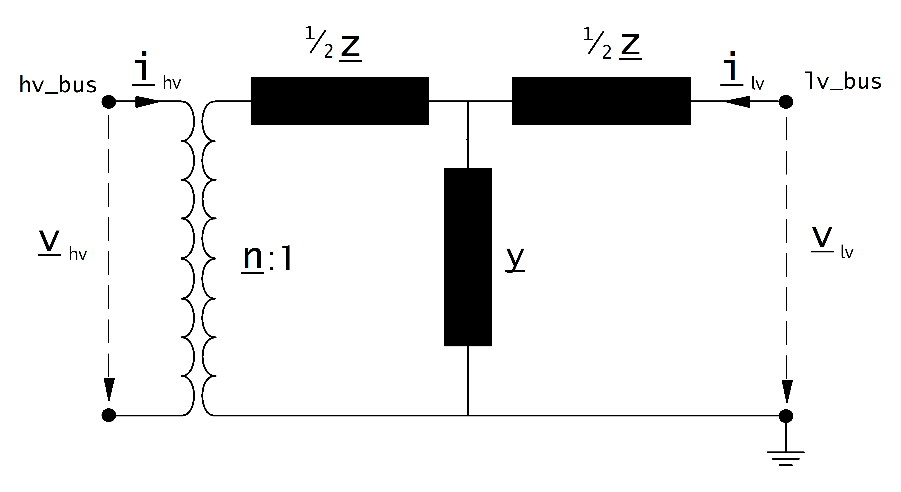
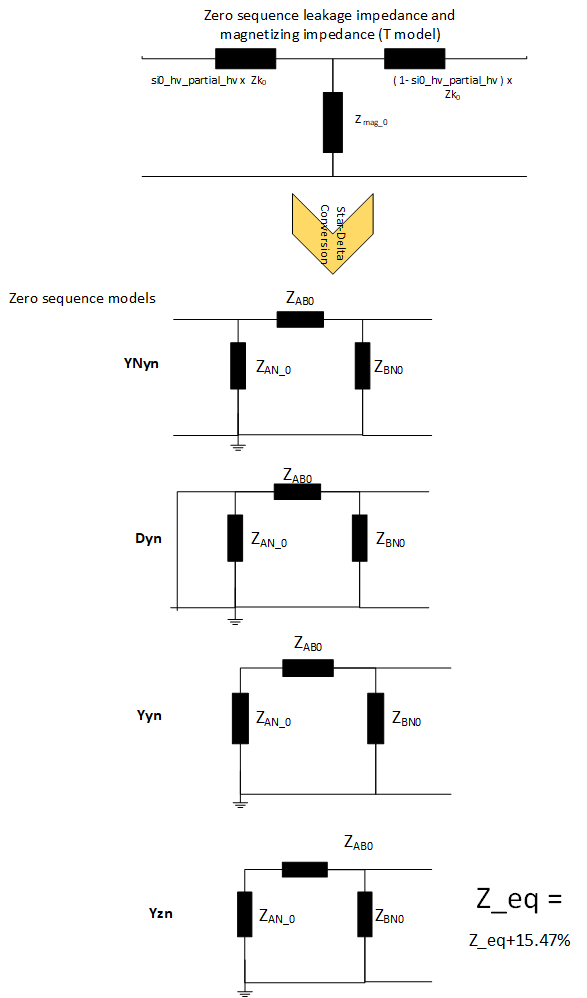
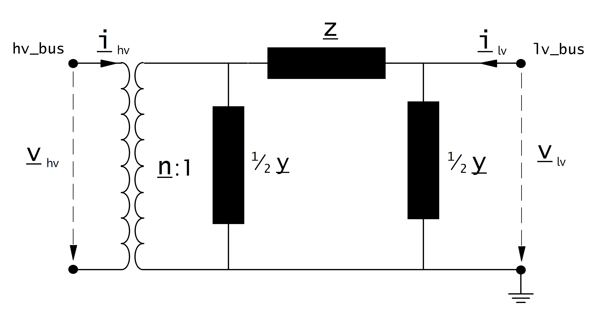

.. _trafo:

=============
Transformer
=============

.. |br| raw:: html

     
    
.. seealso::

    :ref:`Unit Systems and Conventions <conventions>` |br|
    :ref:`Standard Type Libraries <std_types>`

Create Function
=====================

Transformers can be either created from the standard type library (create_transformer) or with custom values (create_transformer_from_parameters).

.. autofunction:: pandapower.create.create_transformer
.. autofunction:: pandapower.create.create_transformers
.. autofunction:: pandapower.create.create_transformer_from_parameters
.. autofunction:: pandapower.create.create_transformers_from_parameters

Table Structure
=====================

*net.trafo*

.. csv-table::
    :file: table_structures/trafo.csv
    :header-rows: 1
    :delim: ,

.. note:: The transformer loading constraint for the optimal power flow corresponds to the option trafo_loading="current":

.. note:: vkr_percent can be calculated as follow :

    .. math::
        :nowrap:

        \begin{align*}
        vkr\_percent &= \frac{P\_cu}{S\_trafo} \cdot 100
        \end{align*}

    | Where
    | P\_cu is the power loss in the copper in kW
    | S\_trafo is the rated apparent power of the transformer in kW

Electric Model
=================

The equivalent circuit used for the transformer can be set in the power flow with the parameter "trafo_model".
   
*trafo_model='t':*

*sequence = 0:*

*trafo_model='pi':*

.. note:: it is possible to specify unequal distributions of leakage resistance and reactance between HV and LV sides

Transformer Ratio
-------------------

The magnitude of the transformer ratio is given as:

.. math::
   :nowrap:
   
   \begin{align*}
   n &= \frac{V_{ref, HV, transformer}}{V_{ref, LV, transformer}} \cdot \frac{V_{ref, LV bus}}{V_{ref, HV bus}}
   \end{align*}

The reference voltages of the high and low voltage buses are taken from the net.bus table. The reference voltage of the transformer is taken directly from the transformer table:

.. math::
   :nowrap:
   
   \begin{align*}
    V_{ref, HV, transformer} &= vn\_hv\_kv \\
    V_{ref, LV, transformer} &= vn\_lv\_kv
   \end{align*}

If the power flow is run with voltage_angles=True, the complex ratio is given as:

.. math::
   :nowrap:
   
   \begin{align*}
   \underline{n} &= n \cdot e^{j \cdot \theta \cdot \frac{\pi}{180}} \\
   \theta &= shift\_degree 
   \end{align*}
   
Otherwise, the ratio does not include a phase shift:

.. math::
   :nowrap:
   
   \begin{align*}
   \underline{n} &= n
   \end{align*}
   
Impedance Values
------------------

The short-circuit impedance is calculated as:

.. math::
   :nowrap:

   \begin{align*}
   z_k &= \frac{vk\_percent}{100} \\
   r_k &= \frac{vkr\_percent}{100} \\
   x_k &= \sqrt{z^2 - r^2} \\
   \underline{z}_k &= r_k + j \cdot x_k
   \end{align*}    

The magnetising admittance is calculated as:

.. math::
   :nowrap:

   \begin{align*}
   y_m &= \frac{i0\_percent}{100} \\
   g_m &= \frac{pfe\_kw}{sn\_mva \cdot 1000} \\
   b_m &= \sqrt{y_m^2 - g_m^2} \\
   \underline{y_m} &= g_m - j \cdot b_m
   \end{align*}    

The values calculated in that way are relative to the rated values of the transformer. To transform them into the per unit system, they have to be converted to the rated values of the network:

.. math::
   :nowrap:

   \begin{align*}
    Z_{N} &= \frac{V_{N}^2}{S_{N}} \\
    Z_{ref, trafo} &= \frac{vn\_lv\_kv^2}{sn\_mva} \\
    \underline{z} &= \underline{z}_k \cdot \frac{Z_{ref, trafo}}{Z_{N}} \\
    \underline{y} &= \underline{y}_m \cdot \frac{Z_{N}}{Z_{ref, trafo}} \\
    \end{align*}

Where the reference voltage :math:`V_{N}` is the nominal voltage at the low voltage side of the transformer and the rated apparent power :math:`S_{N}` is defined system wide in the net object (see :ref:`Unit Systems and Conventions<conventions>`). 

Tap Changer
---------------

**Overview of the transformer models**

The model of a tap changer is defined by tap_changer_type. The table gives the columns that have to be set for each
model (in addition to tap_side, tap_pos, tap_neutral, tap_min and tap_max) and the resulting voltage ratio and phase
shift per tap, with :math:`n = tap\_pos - tap\_neutral` and :math:`\delta u = tap\_step\_percent / 100`. For a tap
changer at the low voltage side, the sign of the angle is inverted. The models are described in the
`ENTSO-E PST modelling guide <https://eepublicdownloads.entsoe.eu/clean-documents/CIM_documents/Grid_Model_CIM/ENTSOE_CGMES_v2.4_28May2014_PSTmodelling.pdf>`_.

.. list-table::
   :header-rows: 1
   :widths: 18, 12, 30, 22, 18

   * - Model
     - tap_changer_type
     - Columns to set
     - Voltage ratio and angle per tap
     - Impedance per tap
   * - Fixed ratio, no tap changer
     - None
     - tap_changer_type None
     - ratio of vn_hv_kv / vn_lv_kv, angle shift_degree
     - constant
   * - In-phase ratio changer (longitudinal regulator, off-circuit or on-load)
     - "Ratio"
     - tap_step_percent = :math:`\delta u` in %, tap_step_degree NaN or 0
     - ratio :math:`1 + n \delta u`, angle 0
     - constant for a tap changer at the high voltage side, scaled with the square of the ratio at the low voltage side
   * - Tabular ratio changer
     - "Tabular"
     - tap_dependency_table True, id_characteristic_table; trafo_characteristic_table with step, voltage_ratio,
       angle_deg = 0, vk_percent, vkr_percent per step
     - voltage_ratio per step, angle 0
     - vk_percent and vkr_percent per step (at the low voltage side additionally scaled with the square of the ratio)
   * - Ideal (linear) phase shifter
     - "Ideal"
     - tap_step_degree = angle per tap step, tap_step_percent NaN or 0 (otherwise error)
     - ratio 1, angle :math:`n \cdot tap\_step\_degree`
     - constant
   * - Symmetrical phase shifter
     - "Symmetrical"
     - tap_step_percent = :math:`\delta u` in %, tap_step_degree 90 (or NaN / 0)
     - ratio 1, angle :math:`2 \arctan(n \delta u / 2)`
     - multiplied with :math:`1 + (n \delta u / 2)^2` (as in PowerFactory)
   * - Quadrature booster
     - "Ratio"
     - tap_step_percent = :math:`\delta u` in %, tap_step_degree = 90
     - ratio :math:`\sqrt{1 + (n \delta u)^2}`, angle :math:`\arctan(n \delta u)`
     - as in-phase ratio changer
   * - Asymmetrical phase shifter
     - "Ratio"
     - tap_step_percent = :math:`\delta u` in %, tap_step_degree = boost angle :math:`\theta`
     - ratio :math:`|1 + n \delta u e^{\mathrm j \theta}|`, angle :math:`\arg(1 + n \delta u e^{\mathrm j \theta})`
     - as in-phase ratio changer
   * - Tabular phase shifter
     - "Tabular"
     - as tabular ratio changer, with angle_deg per step
     - voltage_ratio and angle_deg per step
     - as tabular ratio changer
   * - In-phase changer plus phase shifter on one winding (2-winding transformers only)
     - "Ratio" and tap2_changer_type "Symmetrical", "Ideal" or "Ratio"
     - tap_* for the in-phase changer, tap2_* for the phase shifter, tap2_side = tap_side
     - product of both tap changers
     - per tap changer as above (no combined impedance law)
   * - Ratio changers on two windings, e.g. off-circuit at HV and on-load at LV (2-winding transformers only)
     - "Ratio" and tap2_changer_type "Ratio"
     - tap_side = "hv" with tap_*, tap2_side = "lv" with tap2_*
     - quotient of both ratios
     - per tap changer as above

.. note::
    Validation of the models in the pandapower tests during development:

    - Validated : in-phase ratio changer, tabular ratio changer, tabular phase shifter, asymmetrical phase shifter, ideal phase shifter
    - Not validated: quadrature booster, ideal and symmetrical phase shifter with the tap changer at the low voltage side, symmetrical
      phase shifter with tap_step_degree other than 90, and the combinations with a second tap changer

The available tap changer models of three-winding transformers (one tap changer at the high, medium or low voltage side or at the
star point) are described in :ref:`trafo3w_model`.

**Longitudinal regulator (Ratio Tap Changer)**

A longitudinal regulator can be modeled by setting tap_changer_type to "Ratio" and defining the tap changer voltage step with tap_step_percent.

The reference voltage is then multiplied with the tap factor:

.. math::
   :nowrap:
   
   \begin{align*}
    n_{tap} = 1 + (tap\_pos - tap\_neutral) \cdot \frac{tap\_step\_percent}{100}
    \end{align*}
    
On which side the reference voltage is adapted depends on the :math:`tap\_side` variable:

.. tabularcolumns:: |p{0.2\linewidth}|p{0.15\linewidth}|p{0.15\linewidth}|
.. csv-table:: 
   :file: trafo_tap.csv
   :delim: ;
   :widths: 20, 15, 15

.. note::
    The variables tap_min and tap_max are not considered in the power flow. The user is responsible to ensure that tap_min < tap_pos < tap_max!

**Cross regulator / asymmetrical phase shifter (Ratio Tap Changer)**

In addition to tap_step_percent, the tap_step_degree parameter can be populated to model the fixed angle
:math:`\theta` between the vectors of the input voltage and the additional voltage per tap step :math:`\delta U`
(**not tap-dependent**). The whole additional voltage is added at the tap side. This results in a cross regulator that
affects the magnitude as well as the angle of the output voltage (tap_changer_type "Ratio"):

.. math::
   :nowrap:

   \begin{align*}
    n_{tap} = 1 + (tap\_pos - tap\_neutral) \cdot \frac{tap\_step\_percent}{100} e^{\mathrm j \theta}
    \end{align*}

**Symmetrical phase shifter**

If tap_changer_type is set to "Symmetrical", half of the additional voltage is added at the tap side and half of it
is subtracted at the opposite side:

.. math::
   :nowrap:

   \begin{align*}
    \underline{t}_{tap\_side} &= 1 + \frac{x}{2} e^{\mathrm j \theta}, \qquad
    \underline{t}_{opposite\_side} = 1 - \frac{x}{2} e^{\mathrm j \theta}, \qquad
    x = (tap\_pos - tap\_neutral) \cdot \frac{tap\_step\_percent}{100}
    \end{align*}

:math:`\theta` is given by tap_step_degree and is 90 degree if tap_step_degree is NaN or 0. The rated voltages of the
tap side and of the opposite side are multiplied with :math:`|\underline{t}_{tap\_side}|` and
:math:`|\underline{t}_{opposite\_side}|`, and the phase shift is
:math:`\arg(\underline{t}_{tap\_side}) - \arg(\underline{t}_{opposite\_side})` (inverted for a tap changer at the low
voltage side). For :math:`\theta = 90` degree, the voltage magnitude ratio stays 1 and the phase shift is

.. math::
   :nowrap:

   \begin{align*}
    \theta_{tp} = 2 \cdot \arctan\left(\frac{x}{2}\right)
    \end{align*}

**Ideal phase shifter**

If tap_changer_type is set to "Ideal", the tap changer is modeled as an ideal phase shifter, meaning that a constant
angle shift is added with each tap step and the voltage magnitude is not changed:

.. math::
   :nowrap:

   \begin{align*}
   \underline{n} &= n \cdot e^{j \cdot (\theta + \theta_{tp}) \cdot \frac{\pi}{180}} \\
   \theta &= shift\_degree
   \end{align*}

The angle per tap step is defined in tap_step_degree (the same parameter as for "Ratio" tap changer is used, but with a
different meaning: here it is the angle per tap step):

.. math::
   :nowrap:

   \begin{align*}
   \theta_{tp} = tap\_step\_degree \cdot (tap\_pos - tap\_neutral)
   \end{align*}

If the tap changer is on the low voltage side, the sign of :math:`\theta_{tp}` is inverted.

tap_step_percent is not used for ideal phase shifters and must be NaN (or 0). If it is set to a non-zero value, the
power flow raises an error. The same applies to the second tap changer (tap2_changer_type, tap2_step_degree,
tap2_step_percent).

.. note::
    Since pandapower 4.0, the boolean parameters tap_phase_shifter / tap2_phase_shifter (replaced by tap_changer_type
    in pandapower 3.0) are not supported anymore. A network that still contains tap_phase_shifter (without a
    tap_changer_type column) cannot be calculated and has to be converted with convert_trafo_pst_logic. This is done
    automatically when loading networks saved with pandapower < 3.0: an ideal phase shifter whose angle was given in
    tap_step_percent gets tap_step_degree = 2 * arcsin(tap_step_percent / 200).

**Tabular phase shifter**

If tap_changer_type is set to "Tabular", the transformer ratio and phase angle shift per tap step is defined in the
trafo_characteristic_table (see below). One application of the "Tabular" tap changer type is to represent the
PhaseTapChangerTabular class defined in the CIM CGMES dataset. In this case, tap_dependency_table flag must be set
to True.

.. seealso::

    `ENTSO-E - Phase Shift Transformers Modelling, Version 1.0.0, May 2014 <https://eepublicdownloads.entsoe.eu/clean-documents/CIM_documents/Grid_Model_CIM/ENTSOE_CGMES_v2.4_28May2014_PSTmodelling.pdf>`_
    
    `J. Verboomen, D. Van Hertem, P. H. Schavemaker, W. L. Kling and R. Belmans, "Phase shifting transformers: principles and applications," 2005 International Conference on Future Power Systems, Amsterdam, 2005 <https://ieeexplore.ieee.org/document/1600575/>`_

Trafo characteristic table
----------------------------

A transformer characteristic table (trafo_characteristic_table) can be used to adjust the transformer parameters
(voltage ratio, angle, impedance (Note: Zero sequence components and adjust nominal power factor are also possible
entries, but not yet implemented)) according to the selected tap position. This lookup table is created automatically
from version 3.0 onwards through the CIM CGMES to pandapower converter (if this information is available in the EQ
profile), the powerfactory to pandapower converter, or the user may define this table manually. The
id_characteristic_table variable in net.trafo references the id_characteristic column in net.trafo_characteristic_table
per transformer.

If the tap_dependency_table variable in net.trafo is set to True, this indicates that there is a corresponding
characteristic available in net.trafo_characteristic_table, which overwrites the default trafo parameters
tap_step_percent, tap_step_degree, vk_percent and vkr_percent. If tap_dependency_table is set to True, tapat_star_point
has no effect.

The below table provides an example trafo_characteristic_table, populated for two 2-winding transformers.

.. tabularcolumns:: |p{0.10\linewidth}|p{0.55\linewidth}|p{0.15\linewidth}|p{0.55\linewidth}|p{0.55\linewidth}|p{0.55\linewidth}|p{0.55\linewidth}|p{0.55\linewidth}|p{0.55\linewidth}|p{0.55\linewidth}|p{0.55\linewidth}|p{0.55\linewidth}|p{0.55\linewidth}
.. csv-table::
   :file: trafo_char_table.csv
   :delim: ,
   :widths: 10, 55, 15, 55, 55, 55, 55, 55, 55, 55, 55, 55, 55

.. note::
    - net.trafo_characteristic_table is applicable to both 2-winding and 3-winding transformers; the corresponding impedance parameters are populated accordingly.
    - tap_dependency_table has to be set to True, and id_characteristic_table and tap_changer_type variables need to be populated in order to consider the corresponding trafo_characteristic_table values.
    - Only one tap_dependency_table is supported per 2-winding transformer (there is no tap2_dependency_table variable).

The function pandapower.control.trafo_characteristic_table_diagnostic can be used for sanity checks.
The function pandapower.control.create_trafo_characteristic_object can be used to automatically create
SplineCharacteristic objects and populate the net.trafo_characteristic_spline table according to the
net.trafo_characteristic_table table. An additional column id_characteristic_spline is also created in net.trafo
to set up the reference to the spline characteristics.

The below table provides an example trafo_characteristic_spline table, populated for two 2-winding transformers.

.. tabularcolumns:: |p{0.10\linewidth}|p{0.55\linewidth}|p{0.55\linewidth}|p{0.55\linewidth}|p{0.55\linewidth}|p{0.55\linewidth}|p{0.55\linewidth}|p{0.55\linewidth}|p{0.55\linewidth}|p{0.55\linewidth}|p{0.55\linewidth}|p{0.55\linewidth}
.. csv-table::
   :file: trafo_char_spline.csv
   :delim: ,
   :widths: 10, 55, 55, 55, 55, 55, 55, 55, 55, 55, 55, 55

Result Tables
==========================

*net.res_trafo*

.. csv-table::
    :file: table_structures/res_trafo.csv
    :header-rows: 1
    :delim: ,

.. math::
   :nowrap:
   
   \begin{align*}
    p\_hv\_mw &= Re(\underline{v}_{hv} \cdot \underline{i}^*_{hv}) \\    
    q\_hv\_mvar &= Im(\underline{v}_{hv} \cdot \underline{i}^*_{hv}) \\
    p\_lv\_mw &= Re(\underline{v}_{lv} \cdot \underline{i}^*_{lv}) \\
    q\_lv\_mvar &= Im(\underline{v}_{lv} \cdot \underline{i}^*_{lv}) \\
    pl\_mw &= p\_hv\_mw + p\_lv\_mw \\
    ql\_mvar &= q\_hv\_mvar + q\_lv\_mvar \\
    i\_hv\_ka &= i_{hv} \\
    i\_lv\_ka &= i_{lv}
    \end{align*}
    
*net.res_trafo_3ph*

.. csv-table::
    :file: table_structures/res_trafo_3ph.csv
    :header-rows: 1
    :delim: ,

.. math::
   :nowrap:
   
   \begin{align*}
    p\_hv\_mw_{phase} &= Re(\underline{v}_{hv_{phase}} \cdot \underline{i}^*_{hv_{phase}}) \\    
    q\_hv\_mvar_{phase} &= Im(\underline{v}_{hv_{phase}} \cdot \underline{i}^*_{hv_{phase}}) \\
    p\_lv\_mw_{phase} &= Re(\underline{v}_{lv_{phase}} \cdot \underline{i}^*_{lv_{phase}}) \\
    q\_lv\_mvar_{phase} &= Im(\underline{v}_{lv_{phase}} \cdot \underline{i}^*_{lv_{phase}}) \\
    pl\_mw_{phase} &= p\_hv\_mw_{phase} + p\_lv\_mw_{phase} \\
    ql\_mvar_{phase} &= q\_hv\_mvar_{phase} + q\_lv\_mvar_{phase} \\
    i\_hv\_ka_{phase} &= i_{hv_{phase}} \\
    i\_lv\_ka_{phase}&= i_{lv_{phase}}
    \end{align*}

The definition of the transformer loading depends on the trafo_loading parameter of the power flow.

For trafo_loading="current", the loading is calculated as:

.. math::
   :nowrap:
   
   \begin{align*}  
    loading\_percent &= max(\frac{i_{hv} \cdot vn\_hv\_kv}{sn\_mva}, \frac{i_{lv} \cdot vn\_lv\_kv}{sn\_mva})  \cdot 100
   \end{align*}
    

For trafo_loading="power", the loading is defined as:
    
.. math::
   :nowrap:
   
   \begin{align*}  
    loading\_percent &= max( \frac{i_{hv} \cdot v_{hv}}{sn\_mva}, \frac{i_{lv} \cdot v_{lv}}{sn\_mva}) \cdot 100
    \end{align*} 

*net.res_trafo_sc*

The short-circuit (SC) results are put into *net.res_trafo_sc* with following definitions:

.. csv-table::
    :file: table_structures/res_trafo_sc.csv
    :header-rows: 1
    :delim: ,
